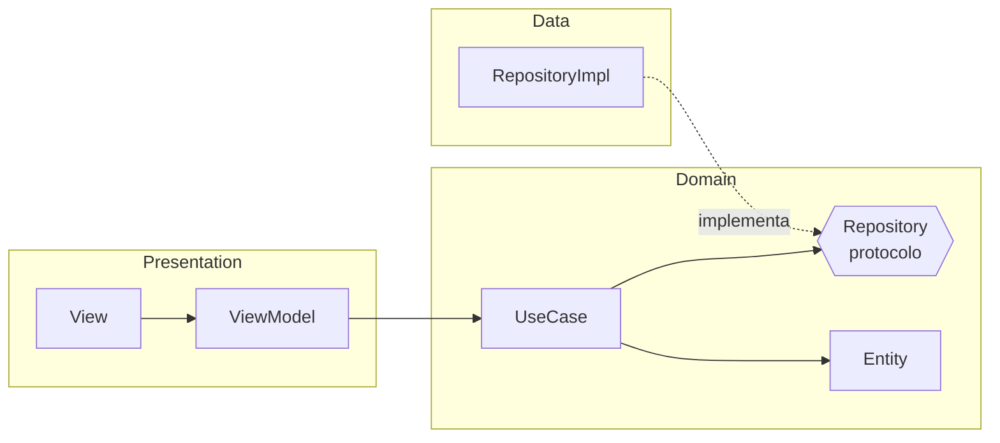

<div align="center">

# 🧩 Xcode Templates

### Genera módulos completos en Xcode con un solo paso


**MVVM** · **Clean** · **VIPER** — en **SwiftUI** y **UIKit**

[Instalación](#-instalación) · [Uso](#-uso) · [Templates](#-templates-incluidos) · [Problemas comunes](#-problemas-comunes)

</div>

---

## ✨ Templates incluidos

| # | Template | Framework | Archivos que genera |
|:-:|----------|:---------:|---------------------|
| 1 | 🟦 **MVVM (SwiftUI)** | SwiftUI | `View` · `ViewModel` |
| 2 | 🟩 **Clean (SwiftUI)** | SwiftUI | `View` · `ViewModel` · `Entity` · `Repository` · `UseCase` · `RepositoryImpl` |
| 3 | 🟧 **MVVM (Storyboard)** | UIKit | `Model` · `ViewModel` · `ViewController` · `Storyboard` |
| 4 | 🟧 **MVVM (XIB)** | UIKit | `Model` · `ViewModel` · `ViewController` · `XIB` |
| 5 | 🟪 **VIPER (Storyboard)** | UIKit | `Protocols` · `Entity` · `Presenter` · `Router` · `Interactor` · `ViewController` · `Storyboard` |
| 6 | 🟪 **VIPER (XIB)** | UIKit | `Protocols` · `Entity` · `Presenter` · `Router` · `Interactor` · `ViewController` · `XIB` |

> [!TIP]
> Los templates de **SwiftUI** usan `@Observable` (Observation), por lo que **no necesitan Combine**. Requieren **iOS 17+**.

### 🏗️ Capas del template Clean (SwiftUI)



---

## 📦 Requisitos

- 🍎 macOS con Xcode instalado en `/Applications/Xcode.app`
- 🔑 Permisos de administrador (el script usa `sudo`)

---

## 🚀 Instalación

**1.** Descarga o clona esta carpeta.

**2.** Abre la app **Terminal** (una ventana normal, no la terminal integrada de un editor).

**3.** Ejecuta el instalador:

```bash
bash ~/Downloads/XcodeTemplates/instalar.sh
```

> Ajusta la ruta si guardaste la carpeta en otro lugar. Te pedirá la contraseña de tu Mac.

**4.** Cierra Xcode por completo con **<kbd>⌘</kbd> + <kbd>Q</kbd>** y ábrelo de nuevo.

> [!WARNING]
> Cada vez que ejecutas el script se **reemplaza** la carpeta `Custom Architectures` completa. Si agregas, quitas o renombras templates, vuelve a ejecutarlo.

<details>
<summary>📍 ¿Dónde se instalan los templates?</summary>

```
/Applications/Xcode.app/Contents/Developer/Platforms/iPhoneOS.platform/Developer/Library/Xcode/Templates/File Templates/iOS/Custom Architectures
```

</details>

---

## 🎯 Uso

1. Abre tu proyecto en Xcode.
2. Clic derecho sobre la carpeta donde quieres el módulo → **New File from Template…**
   (o **File → New → File from Template…**, <kbd>⌘</kbd> + <kbd>N</kbd>).
3. Ve a la pestaña **iOS** y busca la sección **Custom Architectures**.
4. Elige el template y pulsa **Next**.
5. En el campo **Module** escribe el nombre, por ejemplo `Login`.
6. Elige el grupo y el target, y pulsa **Create**.

### 🧪 Ejemplo: MVVM (SwiftUI) con el nombre `Login`

Genera:

```
📄 LoginView.swift
📄 LoginViewModel.swift
```

Y lo usas así:

```swift
@main
struct MiApp: App {
    var body: some Scene {
        WindowGroup {
            LoginView()
        }
    }
}
```

> [!NOTE]
> ¿Quieres algo más completo que MVVM? Usa **Clean (SwiftUI)**, que separa **Presentation**, **Domain** y **Data**.

---

## 🛠️ Problemas comunes

<details>
<summary>❌ <code>sudo: a terminal is required to read the password</code></summary>

Estás ejecutando el script desde un entorno sin terminal interactiva. Ábrelo en la app **Terminal**.

</details>

<details>
<summary>🚫 macOS bloquea el script (archivo descargado)</summary>

Quita la marca de cuarentena y vuelve a intentar:

```bash
xattr -d com.apple.quarantine ~/Downloads/XcodeTemplates/instalar.sh
```

</details>

<details>
<summary>🔒 "Operation not permitted"</summary>

Da acceso a Terminal en **Ajustes del Sistema → Privacidad y seguridad → Gestión de apps** (o **Acceso total al disco**).

</details>

<details>
<summary>👻 Los templates desaparecen después de actualizar Xcode</summary>

Las actualizaciones reemplazan el contenido de `Xcode.app`. Vuelve a ejecutar el script.

</details>

<details>
<summary>🔍 Instalé pero no aparecen</summary>

Asegúrate de haber cerrado Xcode con <kbd>⌘</kbd> + <kbd>Q</kbd> (no solo la ventana).

</details>

---

## ⚙️ Personalización

### 🔢 Cambiar el orden

Xcode ordena los templates con la clave `SortOrder` del `TemplateInfo.plist` de cada uno: el número **menor** aparece primero. Después de cambiarlo, ejecuta de nuevo `instalar.sh` y reinicia Xcode.

### ➕ Agregar un template nuevo

1. Crea una carpeta con extensión `.xctemplate` dentro de esta carpeta.
2. Agrega un `TemplateInfo.plist` y tus archivos `___VARIABLE_productName___*.swift`.
3. Ejecuta `instalar.sh`: instala automáticamente todas las carpetas `*.xctemplate`.

> [!NOTE]
> Los archivos de template contienen placeholders como `___VARIABLE_productName___`. Xcode los reemplaza al generar los archivos, por eso el editor puede mostrar errores si los abres directamente. Es normal.

---

## 📁 Estructura

```
XcodeTemplates/
├── 📜 instalar.sh
├── 📘 README.md
├── 🟩 Clean (SwiftUI).xctemplate
├── 🟦 MVVM (SwiftUI).xctemplate
├── 🟧 MVVM (Storyboard).xctemplate
├── 🟧 MVVM (XIB).xctemplate
├── 🟪 VIPER (Storyboard).xctemplate
└── 🟪 VIPER (XIB).xctemplate
```

---

<div align="center">

Hecho con ❤️ para acelerar la creación de módulos en Xcode

</div>
